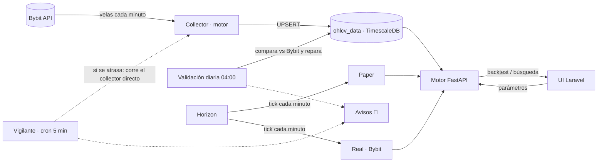

# TR2 — Trading algorítmico

Plataforma de trading algorítmico sobre **Bybit (perpetuos USDT)**: backtesting honesto, búsqueda de configuraciones, paper trading y trading real con la misma lógica. Maneja dinero real: **ningún resultado se da por bueno sin probarlo**.

> Repositorio: `Rcastillo87/tr2` · Servidor: `srv685835` · Raíz: `/home/tr2/htdocs/tr2.srv685835.hstgr.cloud`

---

## Contenido

1. [Reglas de oro](#1-reglas-de-oro)
2. [Arquitectura](#2-arquitectura)
3. [Estructura del proyecto](#3-estructura-del-proyecto)
4. [Módulos](#4-módulos)
5. [Puesta en marcha y migración a otro servidor](#5-puesta-en-marcha-y-migración-a-otro-servidor)
6. [Operación diaria](#6-operación-diaria)
7. [Pruebas forenses](#7-pruebas-forenses)
8. [Cómo hacer cambios](#8-cómo-hacer-cambios)
9. [Diferencias conocidas y pendientes](#9-diferencias-conocidas-y-pendientes)

---

## 1. Reglas de oro

| Regla | En la práctica |
|---|---|
| **Cero asumir** | Todo cambio se valida con logs, pruebas forenses o consultas a la base. Si no se probó, no funciona. |
| **Backtest pesimista** | Peor escenario siempre: cero look-ahead, comisión 0.055 % por lado, slippage 0.05 % por lado, SL primero si en la misma vela se tocan SL y TP. |
| **Cero parámetros quemados** | Todo valor de la UI viaja intacto al motor; los umbrales operativos viven en `config/` y `.env`. |
| **Integridad de datos** | Si no hay velas de 1m que cubran el rango, no se usan. El collector **nunca borra** datos para "reparar". |
| **Misma lógica en todos lados** | Backtest, paper y real usan el mismo constructor de estrategia y el mismo `compute_signals`. Toda lectura de velas pasa por `collectors/bars.py` (orden garantizado, aviso `[BARS]` si la base entregó algo desordenado). |
| **No romper el diseño** | Cambios de vistas solo con maqueta aprobada. |

---

## 2. Arquitectura

| Capa | Tecnología | Dónde corre |
|---|---|---|
| Web / UI | Laravel 13 · PHP 8.4 · Blade + Tailwind · SweetAlert2 | CloudPanel (Nginx + PHP-FPM) |
| Colas | Laravel Horizon · Redis | systemd `trading2-horizon` |
| Motor | FastAPI · Python 3.12 · Pandas/NumPy · asyncpg | systemd `trading2-engine` (`127.0.0.1:8002`, 1 worker) |
| Datos | PostgreSQL 16 + TimescaleDB 2.27 (`ohlcv_data` comprimida; `enable_ordered_append=off` y `plan_cache_mode=force_custom_plan` a nivel de base) | local |
| Exchange | Bybit v5 (`api.bybit.com`; demo en `api-demo.bybit.com`) | — |



**Laravel** es dueño de la UI, los usuarios, las colas y la programación de tareas. **Python** es dueño de toda la matemática: indicadores, señales, motor de backtest, paper, órdenes a Bybit y collector. Se hablan por HTTP interno con la cabecera `X-Internal-API-Key`.

---

## 3. Estructura del proyecto

```
app/
  Console/Commands/CollectorWatchdog.php   vigilante del collector (cron, sin Horizon)
  Http/Controllers/                        Backtesting, Strategy, ParamSearch, Notification, CollectorConfig, Trading…
  Jobs/                                    ticks de paper/real, collector, validación, búsquedas
  Services/                                ParamSearchService, BacktestFromSearch, StrategyConfigSync, SystemAlerts
  Notifications/SystemAlert.php            aviso en la plataforma (canal database)
config/trading.php                         URL del motor, clave interna, vigilante
database/sql-migrations/                   migraciones SQL numeradas (up/down) — se aplican a mano, en orden
ops/                                       dbsql.sh, backtest_from_search.php, logrotate-tr2.conf
python-engine/
  main.py · start.py                       FastAPI (uvicorn 127.0.0.1:8002)
  api/v1/                                  backtest, paper_trading, real_trading, collector, broker, prices, regime
  backtesting/                             motor de backtest y estrategias base
  trading/                                 paper, real, risk_manager (kill switch)
  collectors/                              ohlcv_collector (Bybit), broker_resolver, bars (velas en orden), funding_collector
  tools/analysis/                          filter_audit (auditoría de filtros) y análisis manuales
  cli/                                     param_search, collector_validate, collector_repair, backfill_bybit
  db.py                                    pools asyncpg compartidos (backtest / live / json)
resources/views/                           Blade (param-search/, notifications/, layouts/bell*)
routes/web.php · routes/console.php        rutas y tareas programadas
tests/Forensic/                            pruebas forenses (ver §7)
docs/PROMPT_MAESTRO.md                     instrucciones para quien retome el proyecto (V7.1)
docs/BITACORA.md                           bitácora de cambios (incluye base de datos y servidor)
docs/01–03_*.md                            documentación de julio 2026 (secciones clave actualizadas en V7.1)
docs/archive/                              documentos y resultados viejos
```

Los parches ya no dejan `.bak` dentro del proyecto: los originales quedan en `/root/patches/<parche>/orig/`.

---

## 4. Módulos

### Roles

| Rol | Ve |
|---|---|
| `admin` | Todo: estrategias, backtesting, búsqueda, data collector, usuarios, paper, real, avisos del sistema |
| `consultor` | Backtesting (herramientas de análisis) |
| `inversionista` | Paper y Real (su propia cuenta) |

### Backtesting (`/backtesting`)
- 24 meses de calendario completos hasta el último mes cerrado. Velas de 1m para las salidas cuando cubren todo el rango; si no, se descartan (regla de integridad).
- **Funding de Bybit** descontado en cada trade (pesimista: paga si la liquidación coincide con la entrada o la salida; cobra solo si cae estrictamente dentro).
- **Filtros de apertura:** régimen con **regímenes permitidos** (por defecto los de la estrategia; aviso si con la elección el filtro no bloquea nada), volumen mínimo, tendencia macro H4 (EMA 50) y **tendencia de BTC** (EMA 50 H4 de BTC; solo altcoins; sin velas de BTC no opera). Todos sin mirar al futuro.
- Estrellas = `RatingHelper::calculate(win rate, Sharpe, PF, retorno mensual, consistencia)` por moneda, promediadas.
- **Guardar** guarda en el historial. **Implementar en Paper** es la aprobación. Editar un backtest implementado sincroniza su config en Paper y Real (`StrategyConfigSync`); las posiciones abiertas conservan su `config_snapshot` hasta cerrar.

### Búsqueda de configuración (`/strategies` → 🔍 Buscar) — v3
- Prueba combinaciones de SL, TP, BE, trailing, filtros y duración con el mismo cargador de datos que el backtest (`load_backtest_data`): **búsqueda = backtest**.
- **Enfoque:** mayor ganancia, win rate alto (además PF ≥ 1,2) o consistencia alta. Decide dónde se busca y cómo se ordena.
- **"Gana"** = ≥ 30 operaciones y gana en los primeros 2/3 del periodo **y** en el último 1/3 (que no se usa para elegir).
- **Por moneda:** hasta 5 monedas, todas las temporalidades (1D incluido), cada moneda con su propio ranking. **Por temporalidad:** se acepta si gana en ≥ 3/4 de las monedas y las métricas incluyen **todas** (ninguna se descarta después).
- Prueba el filtro de volumen en ×0,8 / 1,0 / 1,2 / 1,5 y la tendencia de BTC; no prueba el régimen en estrategias que permiten los 3 regímenes (no tendría efecto).
- Corre en la cola `research` (1 proceso, `nice 19` + `ionice`), una moneda a la vez en memoria, tope técnico de 3 h. Una búsqueda corriendo en todo el sistema y una por estrategia.
- Historial con enfoque, modo y monedas probadas; **Eliminar** (solo admin).

### Paper trading (`/paper-trading`)
Tick cada minuto (`PaperTradingTickJob`, único). Misma estrategia, comisión, slippage y **funding** (`paper_trades.funding`) que el backtest. Entra al precio del tick (≤ 1–2 min después del cierre de vela).

### Trading real (`/trading`)
- Cuentas Bybit por usuario (claves API con permisos de **Contratos: Órdenes + Posiciones**; nunca retiros). Cuentas demo = Bybit **Demo Trading** (`api-demo.bybit.com`).
- Tick cada minuto por cuenta (`RealTradingTickJob`), conciliación cada 5 min (`RealTradingReconcileJob`), circuit breaker por pérdida máxima cada minuto.
- SL/TP en el servidor de Bybit (trading-stop); BE, trailing y cierre por tiempo los gestiona el tick.
- Órdenes idempotentes (`orderLinkId` guardado antes de enviar; un `pending_open` se recupera preguntando por esa orden). Chequeo de liquidación al abrir.
- **Límites de riesgo por cuenta** (pérdida máxima del mes y trades abiertos), editables por el dueño en `/trading/accounts`. **Avisos de broker** (`broker_events`) en la campana del dueño.

### Data Collector (`/collector`)
- 12 monedas (BTC, ETH, SOL, XRP, ZEC, HYPE, ENA, DOGE, SUI, NEAR, 1000PEPE, LINK) × 1m, 5m, 15m, 1h, 2h, 4h, 1D = **84 series**, historia desde 2024-06-01 (BNB desactivado; sus velas se conservan).
- Cada minuto: `CollectOhlcvDataJob` → `/v1/collector/run` (4 series en paralelo, UPSERT; nunca dos corridas a la vez).
- **Vigilante** (`collector:watchdog`, cron cada 5 min, no depende de Horizon): revisa el motor, el atraso real de cada serie y si la cola corre el collector. Si algo se atrasa, corre el collector directo. Reinicia el motor o Horizon tras 3 revisiones seguidas con falla (máximo 1 vez cada 30 min por servicio) si está habilitado en `.env`.
- **Validación diaria 04:00 (America/Bogota)**: compara las últimas 300 velas cerradas de cada serie con Bybit y el historial completo (velas esperadas vs guardadas, sin `lag()`). Luego **repara** lo que falle: vuelve a descargar de Bybit y guarda con UPSERT, **nunca borra**, máximo 7 días por serie por pasada. Los días que Bybit tampoco tiene completos se registran en `storage/app/collector_bybit_gaps.json` y dejan de contar como huecos.

### Avisos (🔔 en la cabecera · `/avisos`)
- Tabla `notifications` (canal database, envío síncrono: no depende de Horizon). Retención 30 días.
- **Sistema** (collector, motor, cola, validación, reparación, búsquedas) → solo el **admin**. **Broker** → solo el **dueño de la cuenta** (`SystemAlerts::notifyUser`).
- Sin spam: un incidente avisa al abrirse y al cerrarse ("Duró X min"), no cada 5 minutos.

---

## 5. Puesta en marcha y migración a otro servidor

### Requisitos
Ubuntu 24.04 · PHP 8.4 (+ pgsql, redis, mbstring, xml, curl, zip) · Composer · Node 20+ · Python 3.12 + venv · PostgreSQL 16 + TimescaleDB 2.x · Redis · Nginx · cron.

### Pasos

```bash
# 1. Código
git clone git@github.com:Rcastillo87/tr2.git /home/tr2/htdocs/tr2.srv685835.hstgr.cloud
cd /home/tr2/htdocs/tr2.srv685835.hstgr.cloud
composer install --no-dev --optimize-autoloader
npm ci && npm run build

# 2. Entorno Laravel (copiar del servidor anterior o partir de .env.example)
cp .env.example .env && php artisan key:generate
#    Variables propias de TR2: PYTHON_ENGINE_URL, PYTHON_INTERNAL_API_KEY, SYMBOLS, INTERVALS,
#    ALLOW_INVESTOR_DEMO_ACCOUNTS, WATCHDOG_RESTART_ENGINE, WATCHDOG_RESTART_HORIZON
#    (opcionales: WATCHDOG_FAILS_TO_RESTART, WATCHDOG_RESTART_COOLDOWN_S, WATCHDOG_QUEUE_STALE_S, WATCHDOG_SERIES_GRACE_S)

# 3. Motor Python (su propio python-engine/.env: copiar del servidor anterior)
cd python-engine && python3.12 -m venv venv && venv/bin/pip install -r requirements.txt && cd ..

# 4. Base de datos: restaurar un respaldo (pg_dump) o crear desde cero
php artisan migrate --force
for f in database/sql-migrations/*.up.sql; do bash ops/dbsql.sh -v ON_ERROR_STOP=1 -1 -f "$f"; done   # en orden (por nombre)
# Ajustes de la base (como postgres; ver docs/BITACORA.md):
runuser -u postgres -- psql -c "ALTER DATABASE trading2 SET timescaledb.enable_ordered_append = off" -c "ALTER DATABASE trading2 SET plan_cache_mode = force_custom_plan"
runuser -u postgres -- psql -c "ALTER SYSTEM SET maintenance_work_mem = '256MB'" -c "ALTER SYSTEM SET autovacuum_work_mem = '128MB'" -c "SELECT pg_reload_conf()"
```

**Migraciones SQL** (`database/sql-migrations/`, cada una con su `.down.sql`):

| # | Qué hace |
|---|---|
| 01 | Identidad de configs para Auto-Sync |
| 02 | `vol_widened` en trades |
| 03 | Elimina IG (respaldado aparte) |
| 04 | Compresión TimescaleDB de `ohlcv_data` (segmentby broker, symbol, interval; política 14 días) |
| 05 | Quita `credentials_extra` |
| 06 | `param_search_runs` (búsquedas) |
| 07 | Una búsqueda corriendo en todo el sistema y una por estrategia |
| 08 | `notifications` (avisos) |
| 10-27 01 | `broker_events` (avisos de broker) |
| 10-27 02 | `real_trades.order_link_id` (órdenes idempotentes) |
| 10-27 03 | Límites de riesgo por cuenta |
| 10-27 04 | `funding_rates`, `funding_coverage` |
| 10-27 05 | `paper_trades.funding` |
| 10-27 06 | `param_search_runs.focus` y `mode` (búsqueda v3) |

```bash
# 5. Datos: 2 años de velas (si no se restauró la base)
cd python-engine && nohup nice -n 10 venv/bin/python -m cli.backfill_bybit --days 730 > ../storage/logs/backfill.log 2>&1 &
venv/bin/python cli/collector_validate.py            # debe terminar en "TODO OK"

# 6. Servicios systemd (User=root, Restart=always, RestartSec=5)
#    trading2-engine : WorkingDirectory=…/python-engine · ExecStart=…/python-engine/venv/bin/python start.py
#    trading2-horizon: WorkingDirectory=… · ExecStart=/usr/bin/php artisan horizon
systemctl enable --now trading2-engine trading2-horizon

# 7. Programador (crontab de root)
* * * * * cd /home/tr2/htdocs/tr2.srv685835.hstgr.cloud && php artisan schedule:run >> /dev/null 2>&1

# 8. Logs
cp ops/logrotate-tr2.conf /etc/logrotate.d/tr2
```

### Comprobación final

```bash
systemctl is-active trading2-engine trading2-horizon redis-server postgresql
curl -s http://127.0.0.1:8002/health
php artisan schedule:list            # 11 tareas (ver §6)
php artisan collector:watchdog --dry # "motor OK · series atrasadas 0"
```

---

## 6. Operación diaria

### Tareas programadas (`routes/console.php`, horas en UTC)

| Frecuencia | Tarea |
|---|---|
| cada minuto | `CollectOhlcvDataJob`, `PaperTradingTickJob`, `RealTradingTickJob`, `CircuitBreakerMaxLossJob`, `broker:events` (avisos de broker, en segundo plano) |
| cada 5 min | `RealTradingReconcileJob`, `collector:watchdog` (en segundo plano, sin Horizon) |
| cada 15 min | `DetectMarketRegimeJob` |
| 09:00 UTC (04:00 Bogotá) | `collector-validate-daily` (valida y repara) |
| 09:30 UTC | `alerts-prune` (borra avisos de más de 30 días) |
| 04:35 Bogotá | `broker-events-prune` |

### Colas (Horizon)

| Supervisor | Conexión / cola | Para qué |
|---|---|---|
| `supervisor-1` | `redis` / `high`, `default` | ticks, collector (timeout 60–80 s, `retry_after` 90 s) |
| `supervisor-research` | `redis-research` / `research` (1 proceso) | búsquedas, validación, crear backtests desde la búsqueda (timeout 11100 s, `retry_after` 11400 s) |

### Comandos frecuentes

```bash
cd /home/tr2/htdocs/tr2.srv685835.hstgr.cloud

systemctl restart trading2-engine        # motor (nunca uvicorn a mano ni fuser)
systemctl restart trading2-horizon       # tras cambiar Jobs. ⚠️ mata la búsqueda en curso
php artisan view:clear                   # tras tocar vistas
php artisan config:clear                 # tras tocar config/ o .env

bash ops/dbsql.sh                        # psql con las credenciales del .env (sin imprimirlas)
bash ops/dbsql.sh -c "SELECT id, status FROM param_search_runs WHERE status IN ('queued','running');"

php artisan collector:watchdog --dry                       # diagnóstico del collector
cd python-engine
venv/bin/python cli/collector_validate.py [--solo BTCUSDT]   # validar contra Bybit
venv/bin/python cli/collector_repair.py --dry-run            # qué repararía (sin escribir)
venv/bin/python cli/collector_repair.py [--solo X] [--max-days 7]
venv/bin/python cli/param_search.py --help                   # búsqueda por consola
```

### Kill switch (detiene toda entrada nueva en paper y real)
Fila en `risk_controls` con `reason = 'kill_switch_manual'` y `active = true`. El SQL exacto para activarlo y desactivarlo está en el docstring de `python-engine/trading/risk_manager.py` (se usa ese, no uno escrito a mano).

### Logs
`python-engine/logs/engine.log` · `storage/logs/laravel.log` · `storage/logs/horizon.log` — rotación diaria, 14 días, máx. 50 MB (`ops/logrotate-tr2.conf`, `copytruncate`).

---

## 7. Pruebas forenses

En `tests/Forensic/`. Las `.py` se corren desde `python-engine/` (`venv/bin/python ../tests/Forensic/<archivo>`); las `.php` desde la raíz (`php tests/Forensic/<archivo>`).

| Prueba | Qué garantiza |
|---|---|
| `backtest_form_payload_test.php`, `backtest_payload_chain_test.php/.py` | Los parámetros de la UI llegan intactos al motor |
| `backtest_elements_test.py --strategy all` | ~25 escenarios por estrategia (SL/TP/BE/trailing/filtros) |
| `backtest_coverage_test.py` | Fuente de datos por cobertura real; 1m solo si cubre el rango |
| `engine_rules_test.py`, `bt_compare_test.py` | Reglas del motor y comparación entre versiones |
| `paper_parity_test.py`, `real_parity_test.py`, `strategy_parity_test.py` | Backtest = paper = real con las mismas velas |
| `strategy_vectorize_test.py`, `strategy_signal_diag.py` | Señales vectorizadas idénticas; embudo de señales |
| `autosync_sync_test.php` | Editar un backtest implementado sincroniza paper/real |
| `live_broker_test.py` | Selección del broker en vivo y bloqueo por datos viejos |
| `bybit_sign_test.py`, `real_demo_roundtrip.py` | Firma de Bybit; ida y vuelta real en **demo** (solo `api-demo.bybit.com`) |
| `collector_upsert_test.py`, `collector_integrity_test.py` | Collector: UPSERT y datos idénticos a Bybit |
| `param_search_summary_test.php` | Métricas de la búsqueda = historial de backtest |
| `param_search_v3_test.py`, `param_search_v3_laravel_test.php`, `param_search_cache_test.py` | Búsqueda v3: enfoques, regla de aceptación, modos, caché de 1m |
| `engine_speed_parity_test.py [--real]` | Motor optimizado = motor de referencia (`reference/engine_v3_ref.py`) |
| `bars_order_test.py [--db]` | Velas en orden: la base las entrega ordenadas (sin avisos `[BARS]`) en backtest, vivo y collector |
| `filters_v2_test.py` | Regímenes permitidos y tendencia de BTC: exactos, sin mirar al futuro, sin datos no opera |
| `funding_test.py` | Funding pesimista en los bordes |
| `risk_limits_test.py`, `risk_limits_laravel_test.php` | Límites de riesgo por cuenta |
| `broker_events_test.py`, `broker_events_drain_test.php`, `broker_event_messages_test.php` | Avisos de broker |
| `bybit_order_idempotency_test.py`, `real_recovery_test.py` | Órdenes idempotentes y recuperación de `pending_open` |

---

## 8. Cómo hacer cambios

1. `git status` antes de tocar nada; leer el estado real del archivo.
2. Parches como scripts Python con reemplazos exactos (`replace()` con ancla única) y verificación md5: **abortan sin escribir** si el archivo no es el esperado y se pueden correr dos veces sin efecto.
3. Validar: `php -l` (PHP), `venv/bin/python -m py_compile` (Python), `php artisan view:cache` (Blade).
4. Probar (prueba forense o consulta), y solo entonces `git add -A && git commit`.
5. Si algo falla: `git checkout -- <archivo>` o restaurar el `.bak_NN`.
6. Vistas: maqueta aprobada antes de tocar Blade; después `php artisan view:clear`.
7. Nunca imprimir claves API ni secretos en consola o logs.

---

## 9. Diferencias conocidas y pendientes

**Backtest vs paper/real**
- El backtest entra al open de la vela siguiente; paper/real al precio del tick (≤ 1–2 min después).
- BE, trailing ATR y cierre por tiempo: por vela de 1m en el backtest, por tick (1 min) en vivo.
- Real: slippage real de Bybit y cantidad redondeada al paso del símbolo.

**Mantenimiento de la base**
- La compresión automática de TimescaleDB (cada 12 h) puede dejar **lotes solapados** en fragmentos donde el collector reparó huecos; la lectura ordenada sale desordenada. Detectar: `runuser -u postgres -- psql -d trading2 -tA < /root/patches/batches/detect.sql`. Arreglar: `decompress_chunk` + `compress_chunk` del fragmento. El escudo `bars_frame` protege los resultados mientras tanto (aviso `[BARS]` en el log).

**Pendientes**
- Revisión automática de lotes solapados tras cada compresión.
- Reconciliación paper vs backtest con trades reales.
- Funding en pantalla (diseño listo).
- Medir slippage de altcoins en demo (`real_demo_roundtrip.py` con SOL, SUI, LINK).
- Reescribir `docs/01–03` (julio 2026).

Bitácora de decisiones, commits y cambios de base/servidor: `docs/BITACORA.md`.
